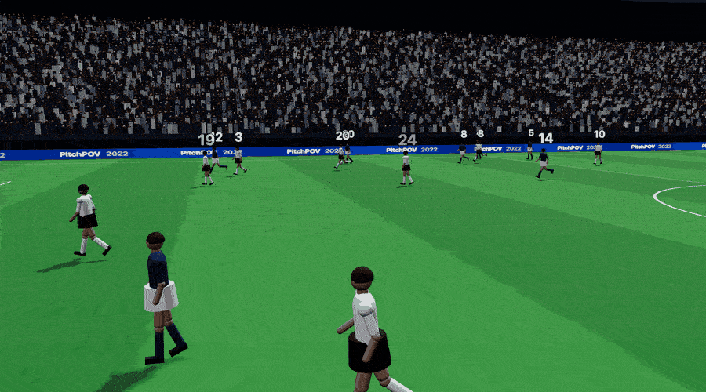

# PitchPOV

A 3D replay viewer for every goal of the 2022 World Cup, built from real player tracking data.

> This is an early working prototype and is still in active development. Expect rough edges.

What works now:

- 166 of the tournament's 172 goals build into clips. Two have no tracking (Croatia v Brazil has
  none for extra time) and four are excluded because neither ball feed is usable at the shot.
- 3D playback of each ~21.5 s clip (15 s before the shot, 6.5 s after) with pause, scrubbing and
  0.25x / 0.5x / 1x speed.
- Orbit camera plus four presets (Follow play, Broadcast, Top-down, Behind goal), and a player's
  point of view by double-clicking him.
- Player names and shirt numbers, a goal browser by round with player and team search.
- 165 pipeline tests (pytest), and the viewer typechecks clean.

## Demo



Mbappé's 81st-minute volley in the final. The GIF is rendered frame by frame from the viewer with
`node web/scripts/capture_demo.mjs` (needs ffmpeg and gifsicle).

Live link: coming soon

## How it works

```
PFF tracking + events          StatsBomb events + 360 frames
(29.97 fps broadcast tracking,     (on-ball actions with body part,
 all 22 players + ball)         shot end points, freeze frames)
            \                          /
             v                        v
        Python pipeline (pipeline/build_all.py)
             |
             v
   one JSON clip per goal + clips/index.json
             |
             v
   React + react-three-fiber viewer (web/)
   interpolates between frames on every animation frame
```

1. **Find the goals.** Goals are PFF shots with a goal outcome that are followed by PFF's goal marker.
   Disallowed goals and penalty-shootout kicks are dropped; own goals are found from the goal marker.
2. **Cut the clip.** One pass over each match's tracking file collects the frames around every goal.
   PFF positions are already in metres on a 105 x 68 m pitch centred at (0, 0).
3. **Line up StatsBomb with PFF.** StatsBomb's clock runs from each period's start and PFF's from the
   start of the video, so the offset is fitted per period and then per clip. StatsBomb's 120 x 80
   coordinates are converted to the same pitch.
4. **Fix the tracking.** StatsBomb's shot location, end point and 360 freeze frames are used to
   correct wrong player tracks and swapped labels, place the keeper, and decide which ball feed to
   trust.
5. **Rebuild the ball.** Between touches the ball is a simulated kick (gravity, drag, bounces,
   rolling) solved to reach the next touch at the right time and height. Dribbles, carries, restarts,
   penalties and the ball in the net are handled separately.
6. **Check every clip.** An accuracy report and a quality report run on every clip as written and
   rank the ones that need another look.
7. **View it.** The viewer loads `clips/index.json`, fetches one clip at a time and draws it with
   three.js. Ball, players, keeper dives, slides and kick poses are animated from the clip data.

## What was hard

- **Coordinate systems.** PFF uses metres centred on the pitch; StatsBomb uses 120 x 80 yards with the
  team on the ball always attacking the same way. Both have to land on the same pitch.
- **Syncing events to tracking.** PFF's event times can be ~0.5 s off the tracking and its video
  clock drifts within a period, so touches are re-timed to where the tracked ball actually is.
- **Wrong tracks and labels.** PFF sometimes swaps two players or has a player tens of metres from
  where he is; StatsBomb's named 360 frames are used to detect and fix that.
- **Ball physics and smoothness.** The tracked ball has gaps and jumps. It is rebuilt as physical
  flights between touches so it doesn't turn or speed up with nobody touching it.
- **Players off camera.** Broadcast tracking estimates players the camera can't see, and those
  estimates can freeze or drift. They are corrected where StatsBomb has evidence, and left alone
  otherwise.

## Running it locally

### a. Requirements

- Python 3.13 (see `.python-version`)
- Node.js 24 (see `web/.nvmrc`; Vite 8 needs at least 20.19 or 22.12)
- About 5 GB of disk for the raw data and about 50 MB for the built clips

### b. Getting the data

Neither dataset is included in this repository.

**PFF FC / Gradient Sports 2022 World Cup dataset.** Free, but needs a sign-up:
[gradientsports.com/blog/enhanced-2022-world-cup-dataset](https://www.gradientsports.com/blog/enhanced-2022-world-cup-dataset).
The download has one file per match (the match id is a number like `10517`) in four folders. Put them
in `data/raw/` with these names:

| Download folder | Goes in             | File per match       |
| --------------- | ------------------- | -------------------- |
| Event Data      | `data/raw/events`   | `{id}.json`          |
| Metadata        | `data/raw/metadata` | `{id}.json`          |
| Rosters         | `data/raw/rosters`  | `{id}.json`          |
| Tracking Data   | `data/raw/tracking` | `{id}.jsonl.bz2`     |

Leave the tracking files compressed. A match is built only if all four of its files are there.

**StatsBomb Open Data.** Public: [github.com/statsbomb/open-data](https://github.com/statsbomb/open-data).
The pipeline needs the 2022 World Cup (competition 43, season 106) match list and, for each match,
the events, lineups and 360 files, in `data/statsbomb/`. From the repository root:

```sh
BASE=https://raw.githubusercontent.com/statsbomb/open-data/master/data
mkdir -p data/statsbomb/matches/43 data/statsbomb/events data/statsbomb/lineups data/statsbomb/three-sixty
curl -fsSL -o data/statsbomb/matches/43/106.json $BASE/matches/43/106.json
for id in $(python3 -c "import json; print(*[m['match_id'] for m in json.load(open('data/statsbomb/matches/43/106.json'))])"); do
  for kind in events lineups three-sixty; do
    curl -fsSL -o data/statsbomb/$kind/$id.json $BASE/$kind/$id.json
  done
done
```

That is 193 files, about 630 MB. Without StatsBomb data the pipeline still runs, but most of the
corrections above are skipped.

The layout the pipeline expects:

```
data/
  raw/
    events/10517.json
    metadata/10517.json
    rosters/10517.json
    tracking/10517.jsonl.bz2
  statsbomb/
    matches/43/106.json
    events/3869685.json
    lineups/3869685.json
    three-sixty/3869685.json
```

### c. Python setup and building the clips

Run everything from the repository root.

```sh
python3.13 -m venv .venv
source .venv/bin/activate
pip install -r requirements.txt
python pipeline/build_all.py
```

`build_all.py` builds every match in `data/raw/`, writes `clips/{gameId}_{gameEventId}.json` per goal
plus `clips/index.json`, and prints a validation report (it also writes `clips/quality_report.md`).
The full build of all 64 matches takes about 2.5 minutes on a 10-core laptop, longer with fewer
cores. It uses every core by default (`--jobs N` to change that).

For a quick test, build one match: put only that match's four files in `data/raw/` (or move the
others out) and run the same command. The final, `10517`, has six goals and takes about
20 seconds. The report will warn that only 1 of 64 matches is present; that is expected.

`pipeline/shot_placement.json` (where each shot crossed the goal line, from StatsBomb) is checked in.
It only needs regenerating if goals are added or removed:

```sh
python pipeline/build_all.py
python pipeline/shot_placement.py
python pipeline/build_all.py
```

### d. Running the viewer

```sh
cd web
npm ci
npm run dev
```

Open http://localhost:5173. The viewer reads clips from `web/public/clips`, which is a symlink to
the top-level `clips/` folder (on Windows, enable symlinks in Git or copy the folder there).

The first goal in the index loads on start. Click **Browse goals** to pick another one by round, or
search for a player or team. A goal can also be linked directly with its clip name, for example
http://localhost:5173/#10517_6738451.

Controls: space to play or pause, the time bar to scrub (arrow keys step when it has focus),
**Jump to shot**, drag to orbit, scroll to zoom, double-click the pitch to fly closer or a player
to see from his position.

### e. Running the tests

```sh
source .venv/bin/activate
python -m pytest            # from the repository root

cd web
npx tsc -b                  # typecheck
npm run lint
```

The tests in `tests/test_confirmed_by_eye.py` check specific built clips against what was confirmed
by watching them. They are skipped for any match you haven't built, so a one-match build shows some
skips.

## Known limitations

- Players are simple low-detail figures with shirt numbers and a few poses, not animated human
  models.
- Some PFF tracks are still wrong where StatsBomb has no frame to correct them, so a player can be
  metres from where he really was.
- A few clips fail quality checks: 69 of 166 pass every check in `clips/quality_report.md`, and 3 are
  flagged by the accuracy report.
- In extra time of the final and Japan v Croatia, PFF's player labels are mixed up; names there are
  only partly recovered.
- Not checked on phones yet.

## Next up

- Ball physics: fewer visible snaps at touches and smoother flights.
- Player motion: running, turning and stopping that reads as human.
- Player models and animations in place of the simple shapes.
- Stadium and camera work for the broadcast and follow views.
- Deploy as a static site with a demo set of clips.

## Data credits

- Tracking, event and roster data: [PFF FC / Gradient Sports 2022 World Cup dataset](https://www.gradientsports.com/blog/enhanced-2022-world-cup-dataset).
- Events, lineups, 360 freeze frames and shot end points: [StatsBomb Open Data](https://github.com/statsbomb/open-data),
  used under the StatsBomb open data licence. Data provided by StatsBomb.

## Tech stack

Python (standard library only, plus pytest, and matplotlib for review plots) for the pipeline; React, TypeScript, Vite, three.js,
react-three-fiber and drei for the viewer.
